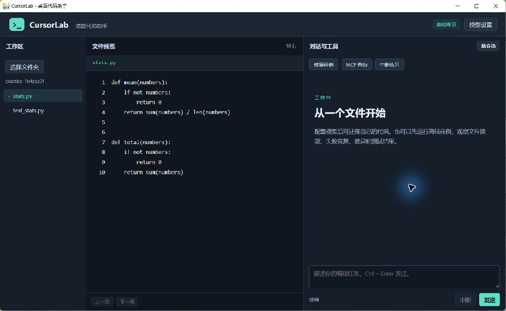
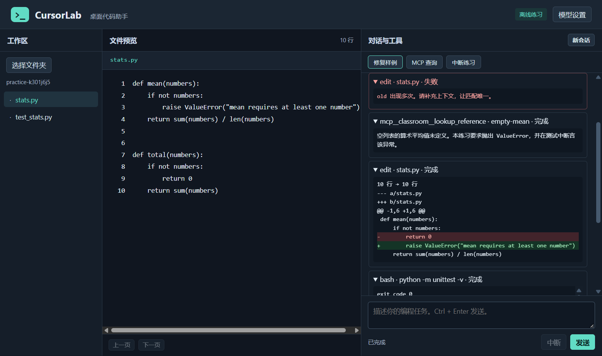
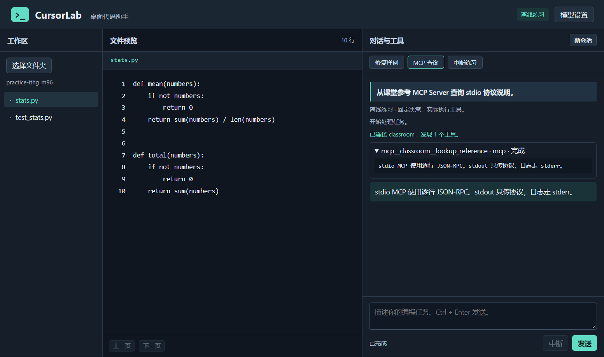

# CursorLab

CursorLab 是一个 Windows 桌面代码助手。左侧选择工作区，中间查看文件，右侧查看对话、工具输入、失败原因、diff 和命令输出。内置工具为 **read、write、edit、bash**。外部工具从 MCP Server 动态发现。

## 三步打开源码版

需要 Windows 10/11 x64、Python 3.12 x64 及 Microsoft Edge WebView2 Runtime。从仓库根目录打开 PowerShell。

1. 创建环境：`py -3.12 -m venv .venv`
2. 安装依赖：`.\.venv\Scripts\python.exe -m pip install .`
3. 打开桌面窗口：`.\.venv\Scripts\python.exe app.py`

使用安装版时，打开 GitHub Release 附件 `CursorLab-Setup-1.0.0-x64.exe`，确认安装后会打开应用。以后可从开始菜单打开 CursorLab。

## 练习和真实任务

- **修复样例** 使用样例的临时副本。第一次 `edit` 因同一片段出现两次而失败。后续调用 MCP 查规则，缩小替换范围，再执行三条单元测试。
- **MCP 查询** 启动一个独立的课堂参考进程，通过 stdio 查询协议说明。**中断练习** 启动 20 秒等待命令，点击「中断」可终止。
- **真实任务** 打开「模型设置」，填写支持 Chat Completions 工具调用的 API 基础地址、模型 ID 和 API Key。选中自己的工作区，再在对话栏输入任务。命令执行前会显示实际命令并等待确认。Key 存在当前进程内存，退出后需要重新填写。

## 三张桌面截图

## 独立运行

不启动窗口即可运行练习：

~~~powershell
.\.venv\Scripts\python.exe -m agent.cli --demo mean
~~~

也可只启动 FastAPI 后端：

~~~powershell
$env:CURSORLAB_TOKEN = [guid]::NewGuid().ToString('N')
.\.venv\Scripts\python.exe app.py --backend --port 8765
~~~

在另一个 PowerShell 窗口将 `$token` 设为上一步的值，运行：

~~~powershell
$headers = @{ 'X-CursorLab-Token' = $token }
$task = Invoke-RestMethod -Uri http://127.0.0.1:8765/api/tasks -Method Post -Headers $headers -ContentType 'application/json' -Body '{"prompt":"Run the sample","demo":"mean"}'
curl.exe -N -H "X-CursorLab-Token: $token" "http://127.0.0.1:8765/api/tasks/$($task.id)/events"
~~~

## 目录

| 路径 | 内容 |
| --- | --- |
| `agent/` | 模型接口、工具、调用循环、MCP 客户端 |
| `server/` | FastAPI、SSE、WebSocket 和任务状态 |
| `ui/` | pywebview 桌面窗口使用的三栏界面 |
| `mcp.json` | stdio Server 配置示例。相对路径基于配置文件所在目录 |
| `mcp_servers/` | 独立的课堂参考 Server |
| `docs/` | 运行记录、截图和打包说明 |
| `report.md` | 架构、工具设计和取舍 |

额外接入 stdio Server 时，复制 `mcp.json`，填入受信任 Server 的 `command` 和 `args`，再使用 `app.py --mcp-config <配置路径>` 启动。Windows 的 `bash` 工具使用 `cmd.exe` 语法。选择工作区只限制文件工具的范围，确认执行的命令具有当前用户的系统权限。
